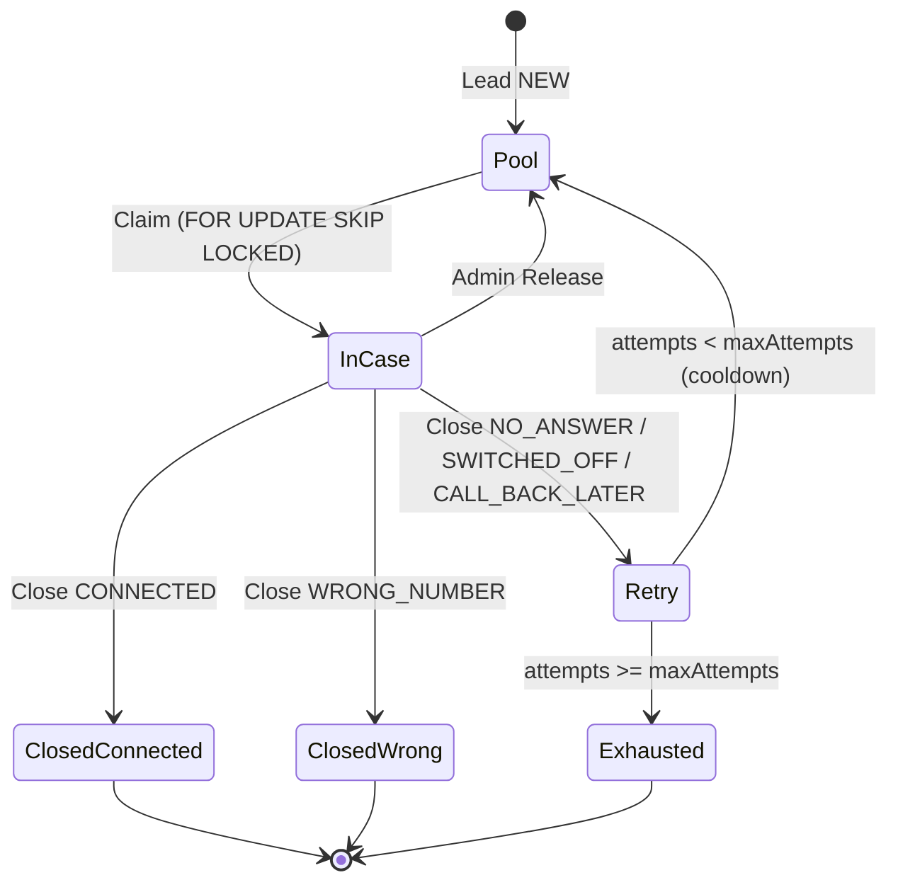
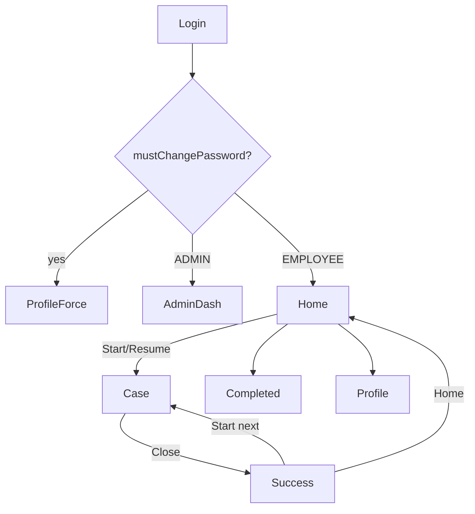
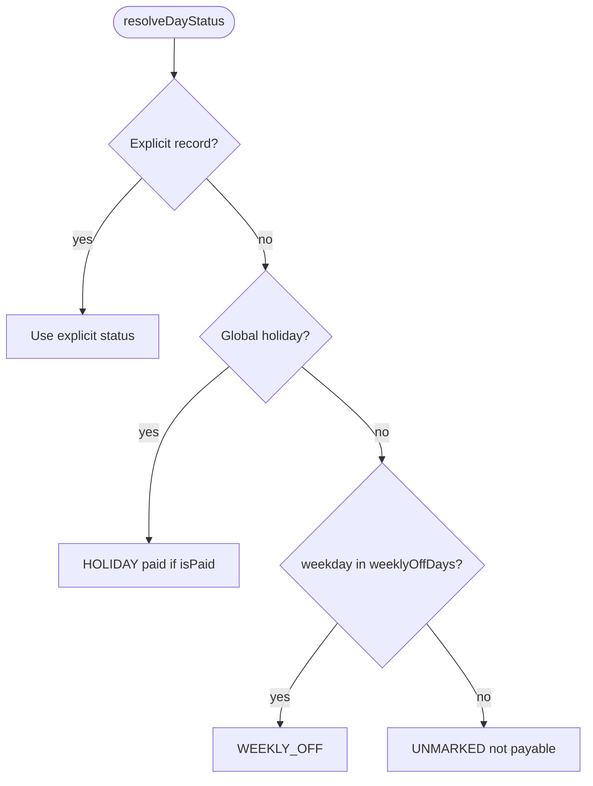
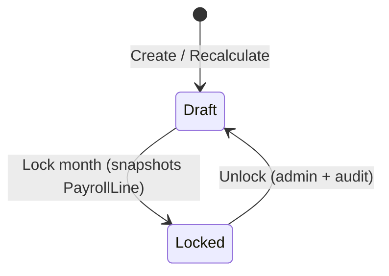

# Flows

Step-by-step flows for Module A (Recruitment CRM) and Module B (Contract Payroll). See also `docs/UI_SPEC.md` for page layouts.

## App settings defaults

| Key | Default |
|---|---|
| `dailyCaseCap` | 200 |
| `maxAttempts` | 3 |
| `retryCooldownHours` | 4 |
| `staleCaseMinutes` | 60 |

---

## 6.1 Claim → Call → Close

### Claim

1. Employee presses **Start next case**.
2. In one transaction: if she has no OPEN case and is under `dailyCaseCap`, pick next lead:
   - `status='NEW' AND (nextEligibleAt IS NULL OR nextEligibleAt <= now())`
   - ordered by `priority DESC, createdAt ASC`
   - `FOR UPDATE SKIP LOCKED LIMIT 1`
   - Prefer a lead she has not attempted before.
3. Create OPEN case, set lead `IN_CASE`, write audit.
4. If pool empty or cap reached → empty/disabled state (no claim).

### Priority

| Source | Priority |
|---|---|
| Referral from case rated 4 or 5 | 10 (warm) |
| Other referrals | 5 |
| Fresh imports / retries | 0 |

### Close

Requires `outcome`.

| Outcome | Rating | Remarks | Lead after |
|---|---|---|---|
| `CONNECTED` | Required 0–5 | Required ≥ 3 chars | `CLOSED` |
| `NO_ANSWER` / `SWITCHED_OFF` / `CALL_BACK_LATER` | Hidden | Optional | `NEW` + cooldown; or `EXHAUSTED` if attempts ≥ max |
| `WRONG_NUMBER` | Hidden | Optional | `CLOSED` (never retried) |

- Increment `attempts` for retry outcomes.
- `durationSeconds = closedAt - startedAt`.
- Referrals optional (see below).
- After close: success screen; **never** auto-claims next.

### Referrals

Rows of `{ phone (required if row present), name?, experienceText?, designation? }`.

- Row with other fields but no phone → error.
- Phones normalised and deduped within the form.
- Existing Lead phone → link only (no status change); message "already in our database".
- New phone → `Lead(source=REFERRAL, referredByLeadId=thisLead, status=NEW)` with name/trade/experience prefilled.

### Joined

- Employee: only on **her own** closed cases.
- Admin: any lead.
- Toggle records `joinedAt`, `joinedMarkedById`, audit.
- Turning off requires confirm dialog.

### Stale cases & pool alerts

- OPEN case older than `staleCaseMinutes` → flagged on admin dashboard; admin can **Release** (reason required).
- Employees cannot skip or release.
- Pool low alert when NEW leads < 10% of total **or** < 50.

---

## 6.2 Import wizard

1. **Upload** — `.xlsx`/`.csv`, ≤ 4 MB, ≤ 20,000 rows; sample template; parse server-side; return headers + first 5 rows.
2. **Map** — map columns; Phone required; auto-guess headers; block Next until Phone mapped.
3. **Review** — counts (valid new / duplicates / invalid); preview 20; error report download; import in chunks of 500 with `createMany({ skipDuplicates: true })`.
4. **Done** — counts + links; `ImportBatch` created. History: Revert deletes only that batch's leads still `NEW` and never claimed.

---

## 6.5 Employee session flow

---

## 8.3 Attendance effective status

- Days before `dateOfJoining` or after `dateOfExit` → greyed hatched, not editable/counted.
- Lock refuses while any employee has unmarked working days unless admin ticks "treat unmarked as absent".

---

## 8.4 Payroll run

Locking writes `PayrollLine` snapshots (inputs + config) so later config changes never alter locked results.
